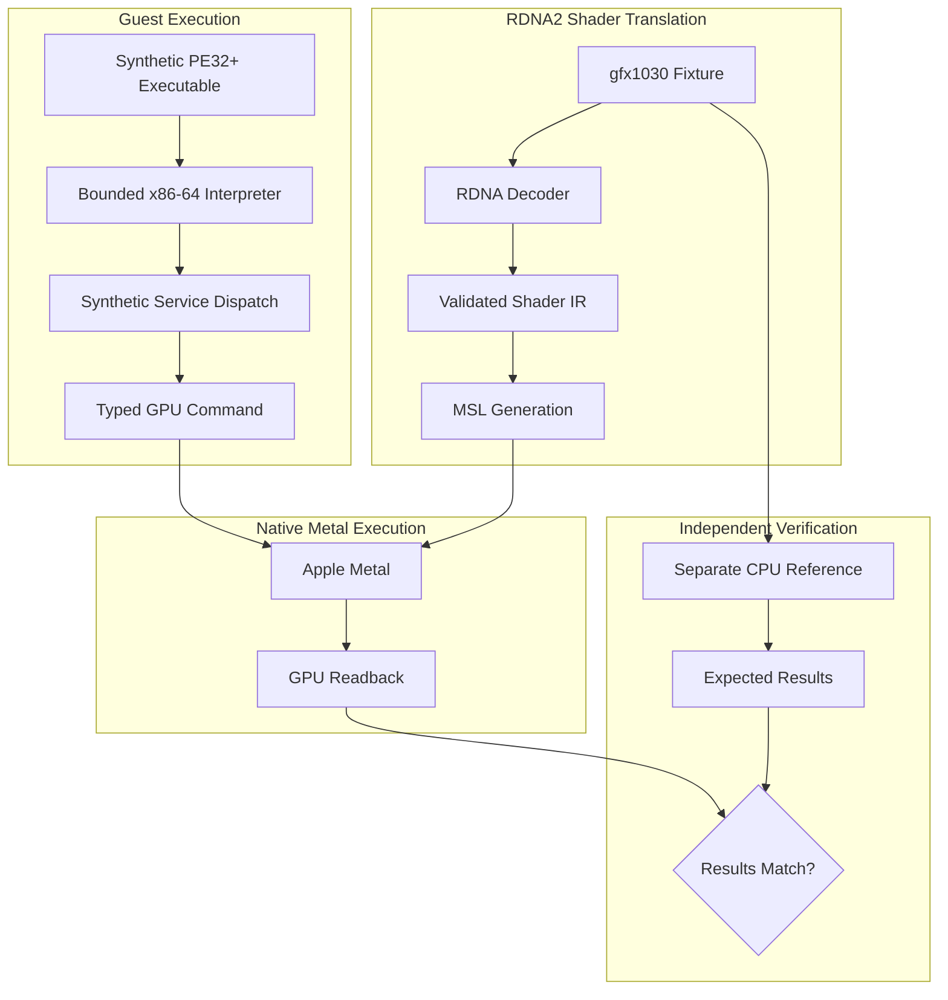

# Xenora

**Xbox Series X|S emulation research for Apple Silicon**

Xenora is an original Rust project targeting native ARM64 macOS. It runs small x86-64 guest programs written for testing and translates a bounded subset of AMD RDNA 2 compute shaders for the desktop gfx1030 target to Metal Shading Language (MSL). Commercial game execution and proprietary Xbox containers are unsupported.

[](https://github.com/ranveersoni98/Xenora/actions/workflows/ci.yml)


## Current status

| Milestone | Demonstrated with original fixtures |
| --- | --- |
| Native guest instruction execution (X1) | Bounded x86-64 interpreter on ARM64 macOS, with checked register, flag and memory results. |
| Executable loading (X2) | Loads fixed-base 64-bit Portable Executable (PE32+) test images and dispatches an experimental add-one service. |
| Guest-to-GPU command submission (X3) | An interpreted guest program submits a validated synthetic compute command to the native Metal backend. Three output words and guest completion were checked. |
| Guest-driven Metal rendering (X4) | An original guest command renders an offscreen 8×8 RGBA8 target on Apple M5. For fixture parameters 17 and 93, independent review checked every pixel against `[x, y, parameter, 255]`. |

The [guest execution baseline](docs/testing/phase-02-baseline.md#implementation-checkpoint) records independent acceptance of X1–X4 and class A native evidence for X3 and X4 on Apple M5.

The [gfx1030 form inventory](docs/shaders/instruction-coverage.md) tracks decoding, lowering, reference execution, CPU tests and Metal readback separately. The verified compute fixtures cover restricted operand forms, including vector-register-only `v_or_b32_e32`, `v_lshlrev_b32_e32` and `v_lshrrev_b32_e32` (class A, Apple M5). Arithmetic right shift (`v_ashrrev_i32_e32`) passed local CPU and Apple M5 readback checks (class A). Independent acceptance remains open.

Per-lane control flow and handling of the execution and vector condition masks (EXEC and VCC) and authentic Xbox command and service interfaces remain open. The recorded Apple M5 runs establish behavior for the tested fixtures on that host.

## Architecture



The guest fixtures submit compute or draw commands with project-defined resource and argument layouts. The gfx1030 fixtures exercise a separate shader translation path. The offscreen render uses an original Metal shader. Xenora runs natively without Rosetta, Wine, CrossOver, MoltenVK or a Vulkan runtime. See the [interface contracts](docs/interfaces.md).

## Build and test

Use native Apple Silicon macOS, Rust 1.100.0 for `aarch64-apple-darwin`, Xcode with Metal tools, and Python 3.11 or later. Native Homebrew LLVM is needed for fixture reassembly.

```sh
scripts/bootstrap.sh
cargo build --locked -p xenora
cargo fmt --all -- --check
cargo clippy --locked --workspace --all-targets -- -D warnings
cargo test --locked --workspace
cargo test --locked --manifest-path experiments/x1/Cargo.toml
scripts/assemble-fixture.sh --check
```

On a Metal-capable Apple Silicon host, run `scripts/test-gpu.sh` for native correctness and `scripts/demo.sh` for the three baseline shader fixtures. The [guest experiment guide](experiments/x1/README.md) covers X1–X4 reproduction. The CI badge covers the hosted Rust and repository checks. Hardware results are recorded in the [validation evidence](tests/validation/README.md).

## Contributing and license

See the [contribution guide](CONTRIBUTING.md) for Developer Certificate of Origin (DCO) sign-off and public-source requirements, and the [legal policy](docs/legal.md) for permitted inputs. Xenora is licensed under the [GNU GPL v3 or later](LICENSE). Third-party notices are listed separately in [THIRD_PARTY_NOTICES.md](THIRD_PARTY_NOTICES.md).
