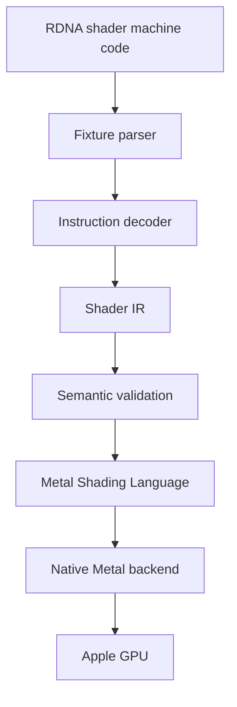

# Xenora

**Xbox architecture. Apple Silicon. Native Metal.**

Xenora is an experimental, open-source recompilation framework for Xbox Series X|S targeting native ARM64 execution on macOS. Its graphics subsystem, **XenoMetal**, is designed to translate RDNA shader machine code into Metal Shading Language (MSL) for execution on Apple GPUs.

Xenora takes a Metal-first approach rather than relying on a Vulkan runtime, MoltenVK, Rosetta 2 or a Windows compatibility layer.

> [!IMPORTANT]
> Xenora is an early-stage research project. Game execution, proprietary Xbox containers and full guest execution-mask divergence are unsupported.

## XenoMetal

XenoMetal is the graphics translation subsystem of Xenora. Its intended scope includes shader decoding, recompilation, GPU resource translation and native Metal execution.

The synthetic compute fixtures run through this pipeline. An independent CPU interpreter executes the original binary for comparison.



Run `scripts/demo.sh` to execute three original gfx1030 compute fixtures on Apple Silicon. Integer addition, bitwise and scalar branch, and restricted FP32 outputs matched the independent CPU reference and hand-derived values on Apple M5 (class A, CLAIM-METAL-M5-RDNA-DEMO). Run `scripts/test-gpu.sh` for native Metal correctness, including offscreen rendering with original MSL (class A, CLAIM-METAL-M5-NATIVE-SUITE). The [status file](docs/status.toml) records the verified scope. SPIR-V may be used as an optional compiler intermediate representation without introducing a Vulkan runtime dependency.

## Development roadmap

The following describes the project's intended development stages, not a claim that the features are already implemented.

| Phase | Focus |
| --- | --- |
| 01 | Native Metal foundations, RDNA decoding, shader IR, MSL generation and reference validation |
| 02 | Upstream research, selective integration and expanded instruction coverage |
| 03 | Graphics pipelines, texture addressing, resource binding and wave semantics |
| 04 | Shader optimization, pipeline caching and Apple Silicon performance |
| 05 | Native x86-64 to ARM64 CPU recompilation |
| 06 | Guest runtime and publicly documented system interfaces |
| 07 | Integrated execution and compatibility validation using authorized test programs |

## Development and testing

Xenora targets the native Rust `aarch64-apple-darwin` toolchain and Apple's Xcode and Metal development tools. The gfx1030 oracle tests check the production and reference decoders against Homebrew LLVM AMDGPU.

Run the standard Rust checks from the workspace root:

```sh
cargo fmt --all -- --check
cargo clippy --workspace --all-targets -- -D warnings
cargo test --workspace
```

Run `scripts/bootstrap.sh` to check the native toolchain and `scripts/assemble-fixture.sh --check` to verify the synthetic gfx1030 fixture with LLVM. The [Phase 01 checkpoint](docs/progress.md) records the implementation and validation status.

## Research and documentation

Xenora draws on publicly available technical specifications and documentation, including:

- [AMD GPU architecture programming documentation](https://gpuopen.com/amd-gpu-architecture-programming-documentation/)
- [AMD machine-readable ISA](https://gpuopen.com/machine-readable-isa/)
- [Apple Metal documentation](https://developer.apple.com/documentation/metal/)
- [Metal resources and specifications](https://developer.apple.com/metal/resources/)
- [Microsoft Game Development Kit](https://learn.microsoft.com/en-us/gaming/gdk/)
- [DirectX specifications](https://microsoft.github.io/DirectX-Specs/)
- [LLVM AMDGPU documentation](https://llvm.org/docs/AMDGPUUsage.html)

Public RDNA 2 specifications do not establish every Xbox-specific GPU behavior. Unknown or undocumented semantics must remain explicitly identified rather than assumed to be equivalent.

## Contributing

Contributions in GPU architecture research, Rust systems programming, shader compilers, Metal development, independent testing and technical documentation are welcome.

Changes should include a clear technical rationale, relevant specification references, meaningful tests and accurate documentation. Upstream code and fixtures must have verified provenance and compatible licensing. AI-assisted contributions are subject to the same review, correctness and attribution requirements as other contributions.

## License

Xenora is licensed under the [GNU General Public License, version 3 or later](LICENSE). Third-party components retain their applicable licenses and copyright notices.

Xenora does not distribute proprietary game binaries, console firmware, encryption keys or restricted Xbox SDK material. The project does not aim to circumvent DRM or console security mechanisms.

Xenora is an independent project and is not affiliated with or endorsed by Microsoft, Xbox, AMD or Apple. All third-party trademarks belong to their respective owners.
