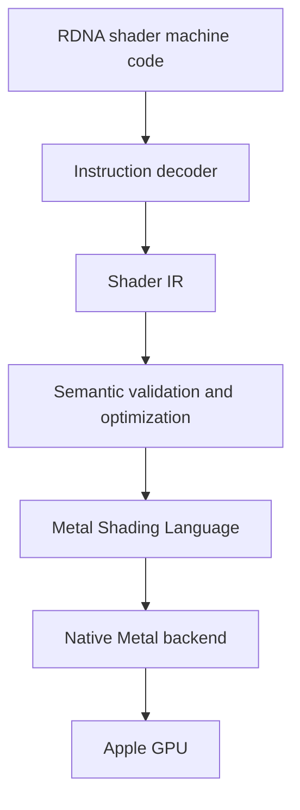

# Xenora

**Xbox architecture. Apple Silicon. Native Metal.**

Xenora is an experimental, open-source recompilation framework for Xbox Series X|S targeting native ARM64 execution on macOS. Its graphics subsystem, **XenoMetal**, is designed to translate RDNA shader machine code into Metal Shading Language (MSL) for execution on Apple GPUs.

Xenora takes a Metal-first approach rather than relying on a Vulkan runtime, MoltenVK, Rosetta 2 or a Windows compatibility layer.

> [!IMPORTANT]
> Xenora is an early-stage research and development project, not a game-ready emulator. Commercial game compatibility, Xbox hardware equivalence and performance superiority have not been established.

## XenoMetal

XenoMetal is the graphics translation subsystem of Xenora. Its intended scope includes shader decoding, recompilation, GPU resource translation and native Metal execution.

The primary compilation pipeline is designed as follows:



An independent CPU reference interpreter is intended to validate supported instruction semantics against known-answer tests and actual GPU output. SPIR-V may be used as an optional compiler intermediate representation without introducing a Vulkan runtime dependency.

## Design principles

- **Native ARM64:** target Apple Silicon directly, without Rosetta.
- **Metal-first graphics:** build around native Metal capabilities rather than recreating another graphics API unnecessarily.
- **Correctness before performance:** validate instruction semantics and observable shader results before optimizing.
- **Evidence-driven development:** distinguish public specifications, implementation assumptions and measured hardware behavior.
- **Independent verification:** use reference implementations, differential tests, fuzzing and mutation testing to detect semantic errors.
- **Clean-room research:** rely on public documentation, original fixtures and legally reusable upstream software.

## Development roadmap

The following describes the project's intended development stages, not a claim that the features are already implemented.

| Phase | Focus |
| --- | --- |
| 01 | Native Metal foundations, RDNA decoding, shader IR, MSL generation and reference validation |
| 02 | Upstream research, selective integration and expanded instruction coverage |
| 03 | Graphics pipelines, texture addressing, resource binding and wave semantics |
| 04 | Shader optimization, pipeline caching and Apple Silicon performance |
| 05 | Native x86-64 to ARM64 CPU recompilation |
| 06 | Guest runtime and publicly documented system interfaces |
| 07 | Integrated execution and compatibility validation using authorized test programs |

## Target platform

| Component | Target |
| --- | --- |
| Guest architecture | Xbox Series X\|S (x86-64 CPU, RDNA 2-derived GPU) |
| Host operating system | macOS |
| Host architecture | ARM64 / AArch64 |
| Host hardware | Apple Silicon |
| Graphics subsystem | XenoMetal |
| Graphics API | Metal |
| Primary language | Rust |
| Supporting languages | C++, Metal Shading Language |

The development target spans Apple Silicon generations, but hardware compatibility must be established through actual testing. Features are not considered supported solely because they compile.

## Development and testing

Xenora targets the native Rust `aarch64-apple-darwin` toolchain and Apple's Xcode and Metal development tools. LLVM's AMDGPU tools are intended to serve as an independent instruction encoding and decoding reference where applicable.

Once the Cargo workspace and build configuration are available, the standard Rust checks are:

```sh
cargo fmt --all -- --check
cargo clippy --workspace --all-targets -- -D warnings
cargo test --workspace
```

These commands are the intended baseline; they do not substitute for real Metal GPU execution tests. Consult the repository's current build and testing documentation for supported toolchain versions and hardware-specific commands.

## Research and documentation

Xenora draws on publicly available technical specifications and documentation, including:

- [AMD GPU architecture programming documentation](https://gpuopen.com/amd-gpu-architecture-programming-documentation/)
- [AMD machine-readable ISA](https://gpuopen.com/machine-readable-isa/)
- [Apple Metal documentation](https://developer.apple.com/documentation/metal/)
- [Metal resources and specifications](https://developer.apple.com/metal/resources/)
- [Microsoft Game Development Kit](https://learn.microsoft.com/en-us/gaming/gdk/)
- [DirectX specifications](https://microsoft.github.io/DirectX-Specs/)
- [LLVM AMDGPU documentation](https://llvm.org/docs/AMDGPUUsage.html)

Public RDNA 2 specifications do not establish every Xbox-specific GPU behavior. Unknown or undocumented semantics must remain explicitly identified rather than assumed to be equivalent.

## Contributing

Contributions in GPU architecture research, Rust systems programming, shader compilers, Metal development, independent testing and technical documentation are welcome.

Changes should include a clear technical rationale, relevant specification references, meaningful tests and accurate documentation. Upstream code and fixtures must have verified provenance and compatible licensing. AI-assisted contributions are subject to the same review, correctness and attribution requirements as other contributions.

## License

Xenora is intended to be distributed under the GNU General Public License, version 3 or later ([GPL-3.0-or-later](https://www.gnu.org/licenses/gpl-3.0.html)). Third-party components retain their applicable licenses and copyright notices.

Xenora does not distribute proprietary game binaries, console firmware, encryption keys or restricted Xbox SDK material. The project does not aim to circumvent DRM or console security mechanisms.

Xenora is an independent project and is not affiliated with or endorsed by Microsoft, Xbox, AMD or Apple. All third-party trademarks belong to their respective owners.
